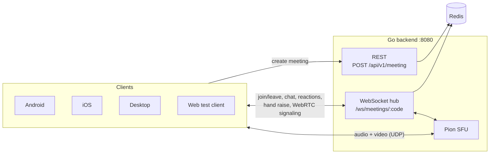

# Leet — Online Video Calls and Messaging

Leet is a group video-calling app. A Go backend acts as a **WebRTC SFU** (Selective Forwarding Unit), and a **Kotlin Multiplatform + Compose Multiplatform** client runs on **Android, iOS and Desktop** from one shared codebase. A small browser client is included for testing.

Create a meeting, share the 8-character code, and everyone who joins sees and hears each other.


---

## Features

- Create a meeting or join one with a code
- Multi-party audio and video calls through an SFU (each client uploads its media once)
- Live participant list: join and leave updates in real time
- Mute/unmute microphone and turn the camera on/off
- In-meeting chat: messages are broadcast live and never stored, so you only see what's sent while you're in the meeting
- Emoji reactions that float up on everyone's screen
- Raise hand: everyone sees it on your tile, including people who join later
- Google Meet–style "Your meeting's ready" card and a Meeting details panel to copy the meeting code
- The web test client supports chat, reactions, raise hand and copying the code too
- Responsive meeting UI: adaptive video grid, side panel on wide screens, bottom sheet on phones
- Runs on Android, iOS, macOS/Windows/Linux desktop, and in the browser (test client)

## Tech stack

| Part | Technology |
| --- | --- |
| Backend | Go, [Gin](https://github.com/gin-gonic/gin), [gorilla/websocket](https://github.com/gorilla/websocket), [Pion WebRTC v4](https://github.com/pion/webrtc), Redis |
| Shared client | Kotlin Multiplatform, Compose Multiplatform, Ktor client (HTTP, WebSockets, [WebRTC](https://ktor.io/docs/client-webrtc.html)), Koin, kotlinx.serialization, Navigation Compose |
| Android | `stream-webrtc-android` (via Ktor WebRTC), `SurfaceViewRenderer` |
| iOS | [WebRTC-SDK](https://github.com/webrtc-sdk/Specs) `137.7151.04`, `RTCMTLVideoView` |
| Desktop | [webrtc-java](https://github.com/devopvoid/webrtc-java) `0.16.0`, frames drawn with Compose |
| Web test client | Plain HTML, CSS and JavaScript (browser WebRTC API) |

## How it works



1. **Create:** `POST /api/v1/meeting` stores a meeting in Redis and returns an 8-character code. The meeting expires after 24 hours.
2. **Join:** the client opens `ws://host:8080/ws/meetings/{code}` and sends `meeting.join` with its name. The server replies with the client's own participant id, the people already in the meeting, and tells everyone else that someone joined.
3. **Media:** the client creates a peer connection with its camera and mic tracks and sends a `webrtc.offer`. The server answers. When other participants publish or leave, the server sends a new `webrtc.offer`, and the client answers it.
4. **Forwarding:** the SFU forwards every track to all other participants. Forwarded track and stream ids are named `"<participantId>:<originalId>"`, which is how clients know whose video a track is.
5. **Chat, reactions, hand raise:** sent over the same WebSocket. The server validates them, adds the sender's identity and broadcasts them. Nothing is stored.

More diagrams (backend packages, SFU media path, join sequence, client layers) are in [docs/architecture.md](docs/architecture.md).

## Documentation

| Doc | What's in it |
| --- | --- |
| [docs/architecture.md](docs/architecture.md) | System and component diagrams, SFU media path, join and chat flows, where state lives, design decisions |
| [docs/protocol.md](docs/protocol.md) | REST endpoint, every WebSocket event and payload, call flow, validation rules and limits |
| [docs/infra.md](docs/infra.md) | Ports, Redis keys, configuration, bandwidth sizing, scaling, production checklist |

## Project structure

```
.
├── apps/
│   ├── api/cmd/                    # Go backend (module "server")
│   │   └── server/
│   │       ├── main.go             # Wires Redis, hub, SFU, handlers; listens on :8080
│   │       ├── routes/             # Gin routes + dev CORS middleware
│   │       ├── handler/            # REST meeting handler, WebSocket + signaling handler
│   │       ├── websockets/         # Client read/write pumps, hub (rooms, broadcast), event types
│   │       ├── media/              # SFU: peers, published tracks, RTP/RTCP forwarding
│   │       ├── services/           # Meeting + participant storage in Redis
│   │       ├── redis/              # Redis client
│   │       └── utils/              # JSON response helpers
│   ├── frontend/                   # Kotlin Multiplatform project
│   │   ├── shared/                 # All shared code (UI, ViewModels, data, domain)
│   │   │   └── src/
│   │   │       ├── commonMain/     # Shared code for every platform
│   │   │       ├── androidMain/    # Android: Koin module, video renderer, permissions, audio
│   │   │       ├── iosMain/        # iOS: Koin module, video renderer, permissions, audio
│   │   │       ├── jvmMain/        # Desktop: Koin module, video renderer
│   │   │       └── nativeMain/     # Apple-native networking bits (host, logger)
│   │   ├── androidApp/             # Android application
│   │   ├── iosApp/                 # Xcode project (+ WebRTCPackage local Swift package)
│   │   └── desktopApp/             # Compose Desktop application
│   └── web-client/                 # Minimal browser client for testing
├── packages/config/                # Shared Go config (Redis env vars)
└── go.work                         # Go workspace (apps/api/cmd + packages/config)
```

## Getting started

### Prerequisites

| Tool | Needed for |
| --- | --- |
| Go 1.27+ | Backend |
| Redis 6+ running on `localhost:6379` | Backend |
| JDK 17+ (Android Studio's bundled JBR works) | Android and desktop builds |
| Android Studio + Android SDK (API 37) | Android |
| Xcode 16+ on macOS | iOS |
| Any modern browser + Python 3 (or any static file server) | Web test client |

### 1. Run the backend

```bash
# Start Redis (if not already running)
redis-server

# From the repository root
cd apps/api/cmd
go run ./server
```

The server listens on **`:8080`**. Check it works:

```bash
curl -X POST http://localhost:8080/api/v1/meeting
```

### 2. Run the clients

All Gradle commands run from `apps/frontend`.

#### Desktop (macOS / Windows / Linux)

```bash
./gradlew :desktopApp:run
```

The first time you join a call, the OS asks for camera and microphone access. On macOS, the permission belongs to the app that launched Gradle (Terminal, IntelliJ, and so on).

To build an installer (DMG/MSI/DEB):

```bash
./gradlew :desktopApp:packageDistributionForCurrentOS
```

#### Android

Open `apps/frontend` in Android Studio and run the **androidApp** configuration, or:

```bash
./gradlew :androidApp:installDebug
```

- Minimum SDK is **28** (required by Ktor WebRTC).
- The app asks for camera and microphone permission when you join a meeting.
- The **emulator** reaches your computer's `localhost` at `10.0.2.2`, which is the default. For a **physical device**, see [Configuration](#configuration).

#### iOS

1. Open `apps/frontend/iosApp/iosApp.xcodeproj` in Xcode.
2. Choose a simulator or device and press **Run**.

Xcode builds the shared Kotlin framework automatically through a build phase (`./gradlew :shared:embedAndSignAppleFrameworkForXcode`). WebRTC comes from the local Swift package in `iosApp/WebRTCPackage`, which downloads the official `WebRTC.xcframework` (`137.7151.04`) on first build.

> If command-line builds fail with an `xcrun`/`xcodebuild` error, point the developer tools at Xcode:
> `sudo xcode-select -s /Applications/Xcode.app`

To run on a real iPhone, set your team in `iosApp/Configuration/Config.xcconfig` (`TEAM_ID=`), and see [Configuration](#configuration) for the server address.

#### Web test client

```bash
cd apps/web-client
python3 -m http.server 3000
```

Open **http://localhost:3000**. Browsers only allow camera access on `localhost` or HTTPS, so don't open it through your computer's IP address.

### Testing a call

1. Start Redis and the backend.
2. Open the web client, enter a name, leave the code empty and press **Join / Create**. The meeting code appears at the top.
3. Join the same code from the desktop app, the Android emulator and/or the iOS simulator.
4. Everyone should see and hear everyone else. Open more browser tabs to add participants.

## Configuration

### Backend

| Variable | Default | Description |
| --- | --- | --- |
| `REDIS_ADDR` | `localhost:6379` | Redis address |
| `REDIS_PASSWORD` | _(empty)_ | Redis password |
| `REDIS_DB` | `0` | Redis database number |

The HTTP/WebSocket port is `8080` (set in `apps/api/cmd/server/main.go`). The SFU uses Google's public STUN server (`stun.l.google.com:19302`). Ports, Redis keys and deploying beyond localhost are covered in [docs/infra.md](docs/infra.md).

### Client server address

The client builds its URLs in `shared/src/commonMain/.../config/network/Endpoints.kt`:

```
http://<host>:8080/api/v1    # REST
ws://<host>:8080             # WebSocket
```

`<host>` defaults per platform (`PlatformHost.*.kt`):

| Platform | Default host | Works for |
| --- | --- | --- |
| Android | `10.0.2.2` | Android emulator |
| iOS | `localhost` | iOS simulator |
| Desktop | `localhost` | Same machine |

For **physical devices**, use your computer's LAN IP (for example `192.168.1.20`). Either change the `PLATFORM_HOST` value or set it at runtime:

```kotlin
Endpoints.host = "192.168.1.20"
```

The phone and the computer must be on the same network.

## API reference

The full reference is in **[docs/protocol.md](docs/protocol.md)**. In short:

- `POST /api/v1/meeting` creates a meeting and returns its 8-character `code`.
- `ws://<host>:8080/ws/meetings/{code}` is the meeting socket. Messages are JSON `{ "type": "...", "data": { ... } }`, and the first one must be `meeting.join`.

| Area | Events |
| --- | --- |
| Meeting | `meeting.join`, `meeting.joined`, `meeting.already_exists_participants`, `meeting.participant_joined`, `meeting.left` |
| Chat | `chat.message` |
| Reactions | `meeting.reaction` |
| Hand raise | `meeting.hand_raise` |
| WebRTC signaling | `webrtc.offer`, `webrtc.answer`, `webrtc.ice_candidate` |
| Errors | `error` (`{ "code", "message" }`) |

## Frontend architecture

The shared module follows a layered (clean) architecture with unidirectional data flow:

```
presentation  ──►  domain  ◄──  data
(Compose UI,       (models,       (DTOs, data sources,
 ViewModels)        interfaces)    repository implementations)
```

| Layer | Key files |
| --- | --- |
| **presentation** | `Home.kt` / `HomeViewModel` (create/join), `Meet.kt` / `MeetViewModel` (call screen), `MeetState`, `MeetAction`, `componenet/VideoContent` and `componenet/MediaPermissions` (`expect`/`actual` per platform) |
| **domain** | `models/` (`Participant`, `MeetEvents`, `Rtc`), `repository/` (`HomeRepository`, `WebSocketRepository`, `MeetingRtcRepository`), `datasource/` interfaces |
| **data** | `KtorWsDataSourceImpl` (meeting WebSocket), `WsMeetingSignaling` (WebRTC signaling on that socket), `KtorWebRtcDataSource` (peer connection and local tracks), `MeetingRtcRepositoryImpl` (offer/answer flow), `MeetingEventMapper` |
| **config** | Koin modules (`AppModules.kt` + one `platformModule` per platform), networking, navigation, `CallAudioSession` (speakerphone routing) |

How the call screen works:

1. `HomeViewModel` creates or joins the meeting and connects the WebSocket, then navigates to the meeting screen.
2. `MeetRoot` asks for camera and mic permission, then sends `MeetAction.StartCall`.
3. `MeetViewModel` calls `MeetingRtcRepository.startCall()`, which captures local media, sends the offer and handles all later signaling.
4. Remote tracks come back as `RtcEvent`s and are stored in `MeetState.remoteVideoTracks` by participant id. `VideoContent` renders them with the native renderer for each platform.
5. Leaving (the button or back navigation) ends the call and closes the WebSocket.

Platform-specific pieces:

| | Android | iOS | Desktop |
| --- | --- | --- | --- |
| WebRTC engine | `AndroidWebRtc` (shared `EglBase`) | `IosWebRtc` | `JvmWebRtc` |
| Video view | `SurfaceViewRenderer` | `RTCMTLVideoView` | Frames converted to Compose `ImageBitmap` |
| Permissions | Runtime permission request | `AVCaptureDevice.requestAccess` | Asked by the OS |
| Audio routing | `MODE_IN_COMMUNICATION` + speaker | `AVAudioSession` video-chat mode (speaker) | System default devices |

## Troubleshooting

| Problem | Fix |
| --- | --- |
| Android can't reach the server | Use `10.0.2.2` on the emulator and your LAN IP on a real device. Cleartext (`http`/`ws`) traffic is allowed in the manifest. |
| `meeting not found` (404) when joining | The code is wrong or more than 24 hours old. Create a new meeting. |
| Video connects but stays black | Check camera permission and that the other person's camera is on. Desktop and Android apps can't tell whether a remote camera is turned off (see [Known limitations](#known-limitations)). |
| No audio on Android/iOS | Check the device isn't muted. The call uses the loudspeaker. |
| Web client: `getUserMedia` fails | Open the page through `http://localhost`, not an IP address. |
| Web client: create meeting fails | Make sure the backend is running and up to date (it needs the CORS middleware). |
| iOS build: `xcrun`/`xcodebuild` error | `sudo xcode-select -s /Applications/Xcode.app` |
| Desktop: `UnsatisfiedLinkError` for webrtc | The `desktopApp` build adds the native `webrtc-java` library for your OS automatically. Supported: macOS (arm64/x64), Windows x64, Linux x64. |
| Calls fail across different networks | Only STUN is configured. Calls between strict NATs need a TURN server. |

## Known limitations

- **Mute and camera-off state isn't shared.** Turning your camera off sends black frames, and other people's tiles don't show you as muted.
- **Screen sharing is UI-only** for now.
- **Video is VP8 only.** The SFU forwards packets without transcoding, so the server offers just VP8 and Opus to make sure every client can decode every stream. (The Android emulator's hardware H264 decoder can't render WebRTC video, and iOS prefers H264.)
- **Chat has no history.** People who join late don't see earlier messages, and messages are gone once you leave.
- **No TURN server**, so some network setups can't connect media.
- **Single server instance.** The SFU state lives in memory, so it doesn't scale horizontally yet.
- The CORS middleware allows every origin. It's meant for local development only.
